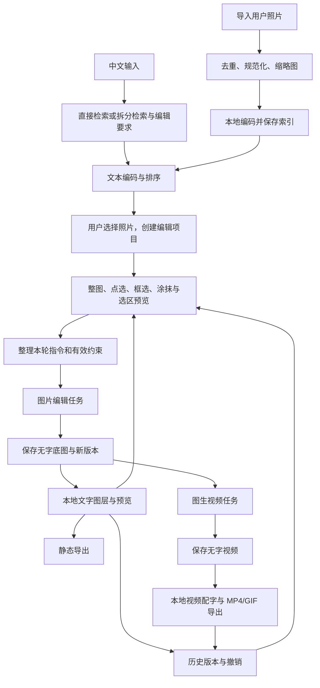

# 个性化静态与动态表情包系统：开发总说明

> 当前实现已完成 P7 技术验收和源码交付。真实静态到动态路径、云端文字复测及独立环境验证见 [P7 阶段记录](P7-阶段记录.md)。后文的初始状态保留为 P0 基线。

文档版本：1.0；编制日期：2026-11-10；既有实测证据基准：2026-11-09；面向：项目成员、指导老师、接手开发的 GPT‑6.1 Sol。

这是一份保留的初始开发规格，不是当前完成报告。下文的初始状态与待实施表述对应 2026-11-10 的 P0 基线。当前实现与实际验证以各阶段记录、课程报告和仓库交付记录为准；没有证据的运行速度、效果和费用不写为实测结果。

## 0. 接手者先读：现在应该做什么

1. 先读第 1—3 节，理解用户的优先级：这是大学课程大作业，完整功能优先，减少重复实验，必须包含真实图生视频能力。
2. 检查实际文件，再读第 2 节的证据。三个 API 已经成功调用，不要重新跑一轮连通性测试。
3. 读第 4—7 节，按数据模型和接口约定建立项目骨架。不要把试验脚本直接当作正式应用后端。
4. 依据配套《开发任务清单》从第一个未完成任务开始。每完成一个阶段，补实际运行证据、已知问题和下一步。
5. 后续实现可以调整内部代码组织，但必须保持用户流程、数据一致性、低成本调用和真实状态说明。范围变化记录原因；不要静默删掉动态生成、区域修正或撤销。
6. 每次接手先运行不收费的检查；默认测试使用本地样例或接口替身。真实生成仅在接通新路径或诊断明确问题时少量执行。
7. 本次交付是文档。本文提到的 `app.py`、数据库、模型管理器、界面等文件尚未创建，不要假定它们已经存在。

### 0.1 状态词汇

| 标记 | 含义 |
| --- | --- |
| 已确认要求 | 用户明确提出的目标与约束 |
| 已验证 | 有真实文件或调用记录支持，必须说明验证范围 |
| 实施默认值 | 为推进项目作出的可修改设计选择，不等于用户逐项指定 |
| 待实现 | 尚无可工作的实现 |
| 待验证 | 文档或设计支持，但本项目尚未实测 |
| 可选扩展 | 不阻塞本版完成，不能挤占必做功能 |

## 1. 目标、边界与开发原则

建议最终题目：**《面向个人图库的中文检索与交互式动态表情包生成系统》**。这里的动态包括图生视频生成的内容；静态图片也是完整输出类型。

用户能够在自己的照片中用中文寻找图片，选择照片，确定整图、主体或局部选区，提出编辑要求，得到静态表情包；继续修改画面或文字，回到历史版本；将静态结果生成动态视频，并保存 PNG、MP4 或 GIF。

### 1.1 已确认要求

- 图库来自用户，不以网上预设图片替代个人图库功能。当前桌面图库只用于开发，不应写死为所有用户唯一可选目录。
- 主要在当前用户电脑开发和演示，Python 团队友好；不要求公开上线、账号注册、多租户或大量并发。
- 完整功能优先，效果达到能用和能解释即可；不做大规模模型训练和效果竞赛。
- 单卡按 8GB 显存设计；不同电脑独立开发或测试，不合并显存，不做跨机训练。
- 文本、图片编辑、视频生成使用已有千问平台 Key；检索与分割优先本地完成。
- 动态生成是本版必做；模板动画可作为补充，不能冒充模型生成视频。
- 文字独立成层；只改文案、样式、位置时不重新生成图片或视频。
- 多轮操作保存版本、约束和选区关联，支持撤销和回到指定版本。
- 不反复用多张图片测试 API 是否能调用。已完成的三次连通性验证保留证据即可。
- 最终仍需 Demo、成员分工和简要技术解释；实验规模由团队缩减，不以虚构结果代替实验。

### 1.2 本版必做功能与实现边界

| 编号 | 必做能力 | 达到什么程度即完成 |
| --- | --- | --- |
| F01 | 个人图库导入 | 本地目录导入和文件上传；读取失败可跳过；用户可换图库 |
| F02 | 可复用索引 | 导入后计算特征；重复搜索和重启不重复编码全部图片 |
| F03 | 中文文字检索 | 返回缩略图与排序；可点选照片；支持明确的标签过滤 |
| F04 | 合并指令拆分 | 将检索描述与生成要求分开；用户能查看和修正拆分结果 |
| F05 | 区域选择 | 整图、框选、涂抹、点选辅助分割；显示、修正、清空选区 |
| F06 | 静态图片编辑 | 参考当前照片进行整图或蒙版编辑；真实 API 返回后保存本地文件 |
| F07 | 独立文字层 | 中文配字、换行、字号、位置、颜色、描边；不收费的本地修改 |
| F08 | 多轮编辑 | 约束增删改、连续画面修改、撤销、恢复、从历史版本继续 |
| F09 | AI 动态生成 | 从当前无字底图生成短视频；修改动作时重新生成一个视频版本 |
| F10 | 视频文字与导出 | 视频后叠加文字；PNG/MP4/GIF 下载；可调 GIF 尺寸、帧率和体积 |
| F11 | 持久化历史 | 程序重启后恢复项目、历史、当前版本和可查询的云端任务 |
| F12 | 失败与费用可见 | 排队、运行、失败、超时分别显示；不静默重交任务；记录实际用量 |
| F13 | 可复现交付 | 安装说明、启动入口、样例操作步骤、分工、依赖版本与已知限制 |

不纳入本版：身份识别训练、人脸库、“我家”关系自动推理、任意历史事件理解、自动跟踪视频文字到运动物体、精确视频局部重绘、音频合成、商业平台发布、数据库集群、模型微调、本地扩散模型训练。

可选扩展：程序抖动/缩放/弹跳动画、透明背景贴纸、项目压缩包迁移、更多检索过滤器、多个文字层的时间轴。只有必做能力完成后再安排。

## 2. 当前真实状态与证据

项目根目录：`C:\Users\23018\Documents\Codex\2026-11-03\1-2-demo-3-5-4\outputs\meme-studio`。

| 项目 | 已确认事实 | 证据/限制 |
| --- | --- | --- |
| 运行系统 | Windows，PowerShell | 当前开发环境 |
| 显卡 | RTX 4060 Laptop GPU，8188 MiB 显存 | `runtime/preflight.json`；微小 CUDA 运算通过，不是模型测速 |
| 可用 Python | `C:\Users\23018\miniconda3\envs\CVFeature311\python.exe`，3.11.17 | 检查阶段借用，不应直接修改该课程环境依赖 |
| PyTorch | 2.8.0+cu128，torchvision 0.23.0+cu128 | 已有环境版本，不等于新项目锁定版本 |
| 测试图库 | `C:\Users\23018\Desktop\测试`，16 张 PNG 均可读取 | 只做过文件检查，未建立检索索引 |
| Key | 用户已填入本地 `.env`，实际调用有效 | 不读取或展示完整内容来“确认” |
| 文本接口 | `qwen-plus` 成功返回；输入 13、输出 1，共 14 Token | `runtime/text_api_check.json` |
| 图片接口 | `wanx2.1-imageedit`，`description_edit`，1 张，`SUCCEEDED` | `runtime/api_smoke/results.json` |
| 视频接口 | `wan2.6-i2v-flash`，3 秒、720P、无声，`SUCCEEDED` | 同上；1 段视频 |
| 素材使用 | 图像和视频测试使用同一张来源图片的适配副本 | `runtime/api_smoke/input.jpg`；非多图实验 |
| 结果下载 | 现有脚本保存了响应与结果 URL | 尚未实现正式产物下载与校验，不承诺临时 URL 永久有效 |

现有文件：`doctor.py`、`check_environment.cmd`、`check_text_api.py`、`check_media_api.py`、`.env.example`、`.env`、`.gitignore`、`settings.json`、`README.md` 和上述运行记录。

以下尚未完成：独立环境、Gradio 应用、Chinese-CLIP 下载与推理、SAM 安装与推理、图库索引、数据库、文字层、版本系统、蒙版编辑调用、正式任务恢复、FFmpeg 配置与导出。

`runtime/preflight.json` 是填写 Key 之前的旧快照，其中 `api_key_present=false` 不代表现在没有 Key；API 成功记录时间更晚。`settings.json` 的 `verified_with_account=true` 只覆盖上表调用，不能解释为所有功能已验收。

### 2.1 现有试验脚本不能直接变成正式后端的原因

- `check_text_api.py` 运行一次就提交一次请求，不要在常规启动时自动运行。
- `check_media_api.py submit` 会记录提交标记以避免重复调用，但缺乏完整异常恢复，网络中断可能留下不明确状态。
- 现有轮询响应处理不能作为最终任务状态机；查询临时失败时必须保留已有任务 ID。
- 现有脚本把图片适配为 768×768，只用于此次连通性检查。正式系统要记录缩放/留白变换和选区映射。
- 现有输出只说明平台任务成功，没有检验身份保持、局部越界、多轮稳定性或最终文件可播放性。
- 保留这些脚本和历史记录；新应用代码放独立模块，不覆盖证据，不为更新文档重复调用。

## 3. 默认技术路线与设计理由

| 层次 | 默认选择 | 职责与理由 |
| --- | --- | --- |
| 界面 | Python + Gradio Blocks | 以本地浏览器交互为主，减少前后端开发负担 |
| 业务逻辑 | 普通 Python 服务函数 | UI 只传 ID 与操作，方便独立测试和替换界面 |
| 数据 | SQLite + 本地文件 | SQLite 管元数据，图片/视频/特征存文件，避免大二进制塞数据库 |
| 检索 | Chinese-CLIP ViT-B-16，冻结 | 一套匹配的图像/文本编码器；中文查询，本地推理 |
| 搜索排序 | NumPy 向量点积 | 小图库无需向量数据库；索引维护简单 |
| 分割 | SAM 2.1 Tiny 图像预测器 | 点/框提示辅助产生选区，仍保留手工修正 |
| 文字理解 | `qwen-plus` | 意图拆分与编辑计划；不负责图像向量检索 |
| 图片编辑 | `wanx2.1-imageedit` | 当前图像+文字；局部模式加蒙版，待接通 |
| 视频生成 | `wan2.6-i2v-flash` | 从当前静态无字底图生成短视频 |
| 配字 | Pillow + 可用中文字体 | 文案与底图独立；换字不用重新生成 |
| 媒体导出 | FFmpeg/ffprobe | 视频叠图、编码、GIF 调色板与文件信息检查 |

三个 API 指三个模型服务用途，不是三个账号或三把 Key。图片/视频提交与查询本身又是不同 HTTP 路径。

### 3.1 必须记录的环境决策

为项目创建独立 Python 3.11 环境，优先放项目 `.venv/`。PyTorch 使用与当前驱动兼容的官方构建，并与 torchvision 成对安装；已有环境运行正常只是参考。先装和验证最小依赖，再锁定版本，避免无依据地把所有依赖更新到最新。

SAM 官方说明以 Linux 为主要安装环境，Windows 推荐 WSL；CUDA 扩展可跳过，但影响部分掩码后处理。先在独立 Windows 环境验证纯推理路径，不预设一定成功；失败时保留手工区域功能，决定是否仅将 SAM 放 WSL 服务运行。切换 WSL 需要额外路径和进程联通工作，不能悄悄变成全项目必须迁移。[SAM 安装说明](https://github.com/facebookresearch/sam2/blob/main/INSTALL.md)

模型管理策略：按需加载；检索和分割的 GPU 操作串行。出现显存不足，先降批量，再将闲置模型移到 CPU/释放引用，必要时明确显示 CPU 模式。不要承诺两个模型同时常驻必定适合 8GB。

## 4. 完整用户流程与模块关系



基本交互顺序：导入 → 搜索 → 选图 → 确定区域和要求 → 生成静态 → 改字/继续编辑 → 生成动态 → 导出。历史操作随时可用；没有选区时局部编辑按钮不能悄悄退化为整图编辑。

用户先选择照片再输入“戴墨镜”时，只进入编辑，不重新搜索图库。用户在搜索页输入“找橘猫，做成戴墨镜表情包”时才拆成两个阶段；编辑要求暂存，选图后带入编辑框，不自动连续提交收费请求。

## 5. 推荐目录和模块职责

以下为目标目录，除第 2 节列出者外均待创建：

```text
meme-studio/
  app.py                       # 创建界面与注册事件
  start.cmd                    # 检查环境后启动本地应用
  pyproject.toml               # 项目与依赖声明
  requirements-lock.txt        # 实测后锁定的依赖
  settings.json                # 非秘密配置、模型名、默认参数
  .env / .env.example          # 本地秘密 / 空模板
  src/meme_studio/
    config.py                  # 配置读取与校验
    schemas.py                 # 类型、枚举、请求和结果结构
    errors.py                  # 业务错误及用户提示映射
    database.py                # 连接、迁移、事务
    repositories.py            # 元数据增删查改
    media_io.py                # 规范化、哈希、缩略图、文件校验
    model_manager.py           # 本地模型生命周期与 GPU 互斥
    gallery.py                 # 导入、删除索引条目、标签
    retrieval.py               # 编码、缓存、排序
    regions.py                 # 坐标、选区、SAM、蒙版
    intent.py                  # 指令解析与结构校验
    constraints.py             # 约束合并、冲突与失效
    versions.py                # 创建版本、切换、分支
    text_layers.py             # 中文文字图层与布局
    composition.py             # 局部合成、静态预览
    exports.py                 # MP4/GIF/PNG 导出
    services.py                # 面向 UI 的工作流入口
    providers/qianwen.py        # 鉴权、HTTP、供应商字段映射
    providers/fake.py           # 明确标记的离线测试替身
    jobs.py                    # 提交、轮询、恢复、下载和费用记录
    ui/                        # 图库、编辑、历史、导出与设置视图
  scripts/                     # 安装检查、模型获取、资料导出
  tests/fixtures/              # 合成小图、模拟响应；不放个人照片
  docs/                       # 本说明、任务清单、答辩资料
  models/                     # 下载权重；Git 忽略
  runtime/
    app.sqlite3
    assets/                   # 内容寻址的图片、蒙版、视频、文字覆盖层
    thumbnails/
    indexes/
    jobs/
    exports/
    logs/
    api_smoke/                # 保留既有测试证据
```

原则：前端组件不调用云端 SDK、不读取 Key、不决定数据库事务；providers 不操作界面；检索代码不知道视频如何导出；任务状态不依赖某次页面回调能否一直活着。

## 6. 数据结构与持久化规则

### 6.1 共同约定

- 所有实体使用稳定 UUID；文件内容使用 SHA‑256。文件名或列表序号不能作为跨重启的主键。
- 数据库内存储项目运行目录下的相对路径；外部来源路径只作导入来源信息。跨机器打开时重新选来源目录即可。
- 日期使用带时区 UTC；界面转为本地时间。JSON 字段带 `schema_version`。
- 图片尺寸按 EXIF 方向纠正后的像素定义；服务层统一 RGB/RGBA，蒙版统一单通道。
- 小配置和约束存 JSON 文本，外键关系存明确列；SQLite 启用外键约束。任务工作线程各用自己的连接。
- 文件先写临时文件、校验后原子更名，再在短事务中写元数据。不要让网络调用持有数据库写锁。

### 6.2 建议表结构

| 表 | 必须具备的字段与含义 |
| --- | --- |
| `galleries` | `id,name,source_dir,created_at`；图库集合 |
| `gallery_images` | `id,gallery_id,source_path,source_hash,asset_id,tags_json,import_status,error_code,created_at`；每张导入图片 |
| `assets` | `id,sha256,relative_path,mime,width,height,duration,byte_size,kind,created_at`；底图、视频、蒙版等实际文件 |
| `feature_sets` | `id,model_name,checkpoint_hash,preprocess_version,dimension,index_path,manifest_path,generation,status`；索引的一次完整快照 |
| `image_features` | `image_id,feature_set_id,row_index,asset_hash`；建立向量行与图片 ID 的显式对应 |
| `projects` | `id,title,source_image_id,root_version_id,current_version_id,created_at,updated_at` |
| `versions` | `id,project_id,parent_id,kind,base_image_asset_id,base_video_asset_id,anchor_image_version_id,text_layers_json,constraints_json,operation_json,job_id,created_at` |
| `regions` | `id,project_id,source_version_id,base_asset_id,base_asset_hash,width,height,mask_asset_id,prompts_json,transform_json,created_at` |
| `jobs` | `id,project_id,source_version_id,kind,local_status,remote_status,model,remote_task_id,request_hash,request_path,result_path,error_code,created_at,updated_at` |
| `usage_events` | `id,job_id,provider,model,input_tokens,output_tokens,image_count,video_seconds,resolution,audio,estimated_cost,price_revision,created_at` |
| `exports` | `id,version_id,format,options_json,asset_id,created_at` |
| `schema_migrations` | `version,applied_at`；可追溯数据库升级 |

唯一性：`remote_task_id` 在供应商内唯一；同一图库同一来源内容避免重复导入；同一 `job_id` 的成功结果只能创建一次版本；`usage_events` 每个任务终态只入账一次。不要因为轮询十次就计费十次。

这里的费用是本应用估算与记录，实际扣费以平台账单为准。没有单价时估算显示“待配置”，不能显示 0 元冒充免费。

### 6.3 版本快照示例（设计示例，非实际记录）

```json
{
  "schema_version": 1,
  "id": "version-example-2",
  "parent_id": "version-example-1",
  "kind": "text_edit",
  "base_image_asset_id": "same-clean-image-asset",
  "base_video_asset_id": null,
  "text_layers": [{
    "id": "caption-1", "text": "我太难了", "font_id": "configured-cjk-font",
    "font_size_ratio": 0.08, "x": 0.5, "y": 0.88,
    "anchor": "center", "max_width_ratio": 0.9,
    "fill": "#FFFFFF", "stroke_fill": "#000000", "stroke_width_ratio": 0.006
  }],
  "constraints": [{
    "id": "c1", "scope": "image", "target": "subject",
    "text": "保留橘色毛发和条纹", "active": true,
    "origin_version_id": "version-example-1"
  }]
}
```

版本必须保存完整有效约束与文字快照，不能仅存自然语言增量。原图和已成功版本不可原地覆盖。改文字可以复用同一底图；改画面必须新建底图资产。

## 7. 模块接口契约

下表为 Python 服务接口设计，不要求先建立 HTTP REST 服务。结构用 dataclass/Pydantic 等实现并校验，函数名可调整但职责要保持。

| 入口 | 输入 | 输出 | 错误与副作用 |
| --- | --- | --- | --- |
| `import_gallery` | 路径或上传文件列表、图库 ID | 导入/重复/失败计数、图片 ID | 不调用生成 API；失败项独立记录 |
| `ensure_index` | 图库 ID、模型签名 | 可搜索索引 ID、增量统计 | 原索引在新索引成功前继续可用 |
| `search` | 图库 ID、中文查询、K、标签过滤 | 有序 `SearchHit(image_id,score,thumbnail)` | 空查询不调用模型；K 不超过候选数 |
| `parse_intent` | 文本、当前页面/项目状态 | `IntentPlan` | JSON 不合法则返回可编辑原文，不自动生成 |
| `create_project` | 图片 ID | 项目 ID、根版本 ID | 建立只读原图引用和初始快照 |
| `make_region` | 当前底图 ID、点/框/笔画、模式 | 绑定底图的蒙版、预览 | 越界、空选区、尺寸不符拒绝提交 |
| `submit_image_edit` | 项目/版本 ID、区域 ID 或整图、指令、约束 | 本地任务 ID | 原子冻结输入，最多提交一个云任务 |
| `update_text` | 版本 ID、图层操作 | 新版本 ID、预览 | 不调用图片/视频 API；普通表单也不调用 LLM |
| `update_constraints` | 版本 ID、添加/替换/删除 | 新版本 ID | 只改约束不自动重新生成 |
| `submit_video` | 静态锚点版本、动作要求、参数 | 本地任务 ID | 不发送文字合成后的图片，避免模型扭曲配字 |
| `poll_job` | 本地任务 ID | 保留任务 ID 的状态快照 | 查询失败不重交，不丢失原状态 |
| `finalize_job` | 成功远程响应 | 本地资产和新版本 ID | 下载/校验失败可重试下载，不重生成 |
| `checkout_version` | 项目 ID、目标版本 ID | 当前快照 | 不生成新图片；禁止跨项目切换 |
| `undo` | 项目 ID | 父版本快照 | 根版本返回“已经是原始版本” |
| `export_version` | 版本 ID、格式、输出参数 | 本地导出文件与元数据 | 相同参数可复用缓存，不计生成费 |

公共错误结构：`AppError(code,user_message,retryable,job_id,details_ref)`；界面显示可理解的中文，技术细节写脱敏日志。

## 8. 图库导入与检索的详细实现

### 8.1 导入

1. 支持目录选择/目录输入和多文件上传；当前默认目录来自配置，允许更改。
2. 路径用 `pathlib`，正确处理中文、空格、长文件名。导入只读取来源，不移动、改名或删除用户原图。
3. 先支持 JPEG/PNG/WEBP/BMP；HEIC 等未支持格式明确提示，不伪装成成功。
4. 逐文件检查可解码性、像素数和文件大小，设可配置上限；压缩炸弹警告不能一律关闭。
5. 纠正 EXIF 方向，处理透明通道和色彩模式，去掉生成副本中的非必要元数据；原图保持原状。
6. 计算来源哈希，生成规范化副本与缩略图；复制到项目管理目录，避免上传临时文件失效。
7. 记录重复/新增/失败，不因一张坏图中止整个导入。
8. 标签由用户编辑，如“我家猫”“小王”“毕业旅行”；没有标签或元数据就不能自动推断这些概念。
9. 从图库移除仅取消索引/关联，不删除桌面文件；仍被历史版本引用的资产保留。

### 8.2 模型、编码和缓存

Chinese-CLIP ViT-B-16 使用匹配的视觉与中文文本分支。使用官方加载接口返回的预处理及对应 tokenizer；本地保存来源、版本、检查点哈希。其官方仓库列有 ViT-B/16、中文文本骨架及中文跨模态检索用法。[Chinese-CLIP 官方仓库](https://github.com/OFA-Sys/Chinese-CLIP)

实现时：模型 `eval()`，推理不记录梯度；小批量从 4 开始，显存不足减为 1。特征转 CPU float32 后 L2 归一化，记录维度，不把维度硬编码成想当然的数值。实际批量和精度以本机通过为准，不编造吞吐。

相似度：`s_i = (v_i / ||v_i||) · (t / ||t||)`。`v_i` 是第 i 张图片的特征，`t` 是查询文字特征；归一化后的点积等于余弦相似度。分数用于排序，不是“有百分之多少概率匹配”。默认取前 6 张，可调整。

缓存键至少含：规范化图片内容哈希、模型名称、检查点哈希、预处理版本。相同图片/模型/预处理复用缓存；新图只新增编码；改模型必须重建对应索引；删除图必须同步更新行映射。图片矩阵和 ID 清单使用同一个 generation，写好两个文件再切换数据库活动指针。

不要把文字向量和不匹配检查点的图片向量混算。损坏索引能报告并重建；重建失败保留上一个正常索引。没有模型时可浏览图库并手动选图，界面明确显示语义检索尚不可用，不把文件名匹配伪装成 CLIP 检索。

### 8.3 查询语义的边界

- “橘猫趴着”直接做图文相似度检索。
- “我家橘猫”只有存在用户标签时才应用“我家”标签过滤；否则提示不能可靠识别归属，仍可检索可见内容。
- “上次旅行”需要日期/相册信息或用户指定，不由 CLIP 自动记忆。
- “那个人”需要当前指代明确或用户选图，不进行身份猜测。
- 初版不用未经标定的阈值宣称“图库没有相关图片”；显示候选并允许用户重新描述或手选。

## 9. 意图拆分、操作路由和约束管理

### 9.1 先路由后调用

明确按钮动作优先于自然语言猜测。“撤销”“导出”“改配字”按钮走本地逻辑。只有合并自然语言或复杂编辑需要 LLM；不要每次打字都请求 API。

`IntentPlan` 建议字段：`action,search_query,image_instruction,video_instruction,caption,region_required,constraint_add,constraint_remove,needs_clarification,clarification_text`。

`action` 枚举：`search,search_then_edit,edit_image,edit_text,generate_video,edit_video_instruction,update_constraints,undo,checkout,export,clarify`。

模型输入包括当前页面、是否已选图、当前版本类型、有效约束和用户原文。这里不需要把全图库或图片 Base64 发给文本模型。模型输出须按 schema 校验，禁止执行模型返回的任意文件路径、命令或代码。

示例：“找一张橘猫，做成戴墨镜的得意表情包” → `search_query=橘猫`，`image_instruction=戴墨镜，得意的表情包风格`。不能把“戴墨镜”默认加入图库现有照片条件；若用户明确说“找已经戴墨镜的猫”，则应保留该检索要求。

提供“检索描述”和“编辑要求”两个可修改框。解析失败时保留原句并提示用户修正；不无限请求模型修复 JSON。使用已有模型支持的结构化输出方式前核对接口文档，仍需本地验证，不能仅依赖提示词保证格式。[Qwen-Plus 模型说明](https://platform.qianwenai.com/docs/models/qwen-plus)

### 9.2 约束的生命周期

约束分为 `subject` 主体特征、`region` 保护内容、`style` 风格、`motion` 动作、`text` 配字；区分仅本轮和持续生效。界面显示“保留要求”列表，能删除或修改。

- “眼泪再大一点”：更新当前画面，保留仍有效的毛色/条纹/背景等约束。
- “背景保持不变”：新增保护要求；若没有局部蒙版，只能尽力遵循，不宣称像素严格不变。
- “把背景换成蓝色”：与旧背景保护冲突；明确的新要求覆盖同一目标的旧要求，显示替换后的摘要。
- 同一句“背景完全不变并换成海边”：冲突不能自动解决时先让用户修正，不提交付费任务。
- “配字改成我太难了”：只改 text layer；保持图像/视频资产 ID 不变。
- “不要再保留条纹”：删除该约束，不能只在提示词末尾附一句反话。

提示词由当前编辑要求、有效约束、区域范围组成；文本图层不混入画面生成提示词，默认要求生成无字底图。每轮保存最终发送的提示词与版本，便于解释。

图片接口当前设计只使用一张底图与可选蒙版；不要假定可同时发送原图和多张历史参考图。保留原图引用供回溯，重新从原图生成是显式操作。历史约束管理是本系统实现，不代表供应商自动记住此前请求。

## 10. 区域选择、坐标与局部编辑

### 10.1 四种模式均应能从界面操作

| 模式 | 用户操作 | 系统结果 |
| --- | --- | --- |
| 整图 | 选择“整张图片” | 无局部蒙版，明确调用整图编辑 |
| 框选 | 选择框的两个角或拖动矩形 | 可直接把矩形变成蒙版；可再交 SAM 细化主体 |
| 涂抹 | 画笔添加、橡皮擦除 | 从笔画层生成二值蒙版；显示覆盖面积 |
| 点选主体 | 正点选主体、负点排除背景 | SAM 输出候选蒙版；选中后可继续点选和手动修正 |

框选第一版允许“两次点击确定矩形”，界面必须明确说明，不必为拖拽另写复杂前端。点选应支持多点和重置。SAM 选出整只猫不等于适合修改眼睛：局部小器官优先手工涂抹或小框，并预览。

SAM 使用同版本 Tiny 检查点和配置；图像编码随底图缓存，同一底图加点不重新加载模型。不同项目不能共用未区分图片的 predictor 内部状态。模型源码版本、配置、权重路径必须可追溯。[SAM 2 官方实现](https://github.com/facebookresearch/sam2)

### 10.2 坐标定义

选区以当前**无字底图**的像素坐标为准，原点左上角；`x` 向右、`y` 向下。矩形采用 `[x0,y0,x1,y1)` 半开区间；点坐标夹到合法范围。所有预览显示相同底图，不在文字合成图上重新推断主体。

若前端事件给的是显示坐标：显示缩放为 `s`，留白偏移为 `(ox,oy)`，则 `x=(u-ox)/s, y=(v-oy)/s`。点击留白区应拒绝。若组件已经返回原图坐标，就不能再缩放一次。先用一张带坐标格的合成图实测组件行为，记录当前 Gradio 版本的约定。

预处理图像若缩放并补边：`x_api=s*x+pad_x, y_api=s*y+pad_y`。蒙版必须使用同一变换，二值蒙版用最近邻插值，图像用常规图像插值。保存正向和逆向变换，不从输出尺寸猜原始坐标。

蒙版文件保存为与底图对应的单通道 PNG，0 表示保留，255 表示修改。仅把半透明彩色覆盖用于 UI；不能把红色预览覆盖图直接发给 API。涂抹取编辑层的 alpha/笔画信息，不能把整个 composite 中的深色像素当成蒙版。Gradio ImageEditor 的值包含背景、图层与合成结果，具体事件行为需按锁定版本验证。[ImageEditor 官方文档](https://gradio.app/docs/gradio/imageeditor)

### 10.3 提交前必须检查

1. `region.base_asset_id/hash` 与任务输入底图一致。
2. 宽高一致，格式正确，白色像素数大于 0；全白时显示“相当于整图编辑”。
3. 选区已显示给用户；不能只存点击坐标就声称完成分割。
4. 用户改了底图、裁剪、旋转或得到新的生成图后，旧选区失效，即使宽高相同也不能自动复用。
5. 只改文字且底图相同，可复用底图级选区；版本记录仍要说明来源。
6. 返回历史版本时，只有底图哈希和尺寸匹配的历史选区可以恢复；否则要求重新选择。

### 10.4 蒙版编辑与保护区域

整图采用 `description_edit`；局部采用 `description_edit_with_mask`，额外发送 `mask_image_url`。当前已成功的是前者，后者仍需接入时做一次针对性验证。白色区域编辑、黑色区域保留的约定来自官方接口说明。[Wan 2.1 图像编辑接口](https://platform.qianwenai.com/docs/api-reference/image-generation/wan21-general-image-editing/create-task)

可实现“固定选区外内容”本地合成开关：在生成结果可可靠映射回底图像素网格时，使用 `O = M*G + (1-M)*B`，其中 B 原底图、G 生成图、M 为 0—1 蒙版。这样保留蒙版外原像素；边缘内侧可做小范围羽化。不要把这一程序约束说成模型本身完全遵守蒙版。

若输出构图或尺寸异常，无法建立可靠映射，则提示结果需要重新选择/整图保留，不能为了算像素误差强行拉伸对齐。局部合成可能出现接缝、截断新增物体，应允许用户扩大选区再编辑。此开关的默认值和限制要在界面说明，不保证改变眼睛时还能完美保留附近毛发。

## 11. 云端适配器与异步任务

### 11.1 已实测可用配置

当前实际调用成功的基础地址：

```text
文本：https://dashscope.aliyuncs.com/compatible-mode/v1
媒体：https://dashscope.aliyuncs.com/api/v1
```

继续使用已验证配置，不因文档里出现其他域名就自动切换供应商地址。平台文档可能更新或展示其他端点，后续只有明确错误或迁移需求时再核对。地址不硬编码到每个模块。

| 操作 | 请求路径（接对应基础地址） | 核心内容 |
| --- | --- | --- |
| 文本理解 | `POST /chat/completions` | model、messages、长度限制；初版关闭深度思考以控制开销 |
| 图片编辑提交 | `POST /services/aigc/image2image/image-synthesis` | model、input.function、prompt、base_image_url、可选 mask_image_url；n=1 |
| 视频提交 | `POST /services/aigc/video-generation/video-synthesis` | model、input.img_url、prompt；720P、3 秒、audio=false |
| 图片/视频查询 | `GET /tasks/{task_id}` | 使用原任务 ID，保存远程状态和结果 |

Key 仅由后端读取。生成提交携带 `X-DashScope-Async: enable`。本地图片通过受支持的 Base64 数据 URI 发送，只有当前所需图片/蒙版，不发送整个图库。生产代码必须校验图片格式、大小、尺寸；不要直接发送 Windows 文件路径让云端读取。[图片接口](https://platform.qianwenai.com/docs/api-reference/image-generation/wan21-general-image-editing/create-task)、[视频接口](https://platform.qianwenai.com/docs/api-reference/video-generation/wan-image-to-video-first-frame/create-task)

### 11.2 准备输入

统一 `prepare_provider_image()`，返回输入副本、尺寸、颜色/透明处理和坐标变换。按模型当前文档的边长、体积限制处理，参数表放适配器。适配副本去除 EXIF；透明背景在视频输入中合成到明确底色；尽量保留宽高比，必要时补边，不默认拉伸成方形。

云端图片生成返回的尺寸可能与请求副本不同，正式保存前检查。蒙版必须和发送副本匹配，而不是只和桌面原始文件匹配。短视频默认 3 秒 720P 无声已实测成功，后续不要省略这些参数依赖更昂贵的默认值。

### 11.3 本地任务状态机

```text
CREATED → SUBMITTING → QUEUED → RUNNING → REMOTE_SUCCEEDED
                                      → DOWNLOADING → SUCCEEDED
其他分支：SUBMISSION_UNKNOWN / FAILED / PAUSED / RESULT_EXPIRED
```

其中 `remote_status` 保存供应商原状态；`local_status` 保存应用状态。平台 `SUCCEEDED` 不等于本地已经下载并能展示。

提交步骤：

1. 点击生成时冻结来源版本、无字底图、选区、约束、参数和提示词，生成请求哈希。
2. 检查同项目是否已有同输入的活动任务。禁用重复按钮，并用数据库约束/事务防止双击重复提交。
3. 写本地任务，再提交远程请求；拿到远程任务 ID 立即落库。
4. 查询使用持久化任务 ID；轮询间隔建议 3→5→10 秒，后续不超过 15 秒。数值是实现默认值，不是性能保证。
5. 默认等待窗口可设 10 分钟，超时变为“暂未完成，可继续查询”，不能直接认定云端失败或自动重交。
6. 成功后校验响应结构，下载产物，验证文件类型/可解码性、尺寸或时长，成功才创建版本。
7. 结果任务只允许关联一个成功版本。后台完成时若用户已切到其他版本，加入历史并提示，不强行覆盖用户当前视图。

### 11.4 必须处理的网络情况

- 提交前明确失败：给可操作提示；纠正后由用户重新点击。
- POST 已发出但响应丢失：记 `SUBMISSION_UNKNOWN`，不要自动重发。没有任务 ID 时无法可靠查询，提示检查控制台，避免重复计费。
- GET 查询 429/5xx/短暂断网：退避重查同一任务，保留旧远程状态和 ID；不把查询错误覆盖成新提交。
- 下载中断：重试下载，不重新生成；文件扩展名不能代替真实内容校验。
- 临时结果 URL 过期：先查询原任务能否取回；仍不可取时标记过期，不静默重新生成。
- 取消：本版“停止等待”只停止本地轮询；未核实供应商取消支持前，不宣称已取消收费或云端生成。
- 重启：查数据库中的未完成任务并提供恢复查询；不要扫描页面状态猜任务。

### 11.5 结果与日志

产物保存到本地受管理目录，避免只存临时 URL。请求摘要记录模型、功能、参数、输入资产 ID、提示词版本和请求时间。日志不记录 Authorization、完整 Key、Base64 图片或带签名的完整下载 URL。调试信息可保存错误码、request_id、task_id；它们属于项目内部资料，不直接出现在公开报告中。

HTTP 客户端设置连接和读取超时；限制下载大小；对结果 URL 只接受符合预期的 HTTPS 地址，拒绝本地路径和可疑内网重定向。下载请求不附带模型 API Key。

## 12. 独立文字层与静态预览

先完成一个主文字层，同时数据结构用列表以便扩展。必备：文案、多行、字号、位置、字体、填充色、描边色、描边宽度；拖动不是首版必要条件，可用九宫格位置+偏移滑块。

实现步骤：

1. 查找可用中文字体，允许配置字体路径。缺字体时给明确错误，不生成方框字并当成成功。
2. 字体若随项目分发，选可分发字体并保留许可证；不能把系统商业字体直接打包共享。
3. 使用实际字形测量进行自动换行与缩字号，不用字符数×字号估宽。留安全边距，考虑描边范围。
4. 先渲染 RGBA 透明文字覆盖层，再叠到无字底图；导出图不反过来作为下一轮画面编辑的底图。
5. 规范位置和字号使用相对值；输出改变大小时重新布局，保持文字可读。
6. 文案为空代表隐藏文字；不强迫调用模型生成文字。特殊符号和不支持 Emoji 时提示可替换字符。
7. 文字更新创建轻量新版本，复用底图/视频；预览可以缓存，但提交版本时保存文字配置快照。
8. 缓存键包含底图哈希、文字 JSON、字体文件哈希、输出尺寸及渲染器版本。

必须证明“只改字”路径不会请求图片/视频接口，且 `base_image_asset_id` 或 `base_video_asset_id` 不变。固定操作按钮应完全本地；自然语言改字若用 LLM 解析，也只能发生文本请求，并在记录中区分。

## 13. 多轮编辑、撤销与分支

### 13.1 不可变版本模型

每次成功编辑产生子版本；失败不改当前成功版本。`project.current_version_id` 是可移动指针。撤销移动到父版本；恢复某版本移动到指定 ID；从旧版本再次编辑创建新分支，保留原有后续版本。

初版历史界面可以显示带缩略图的列表：版本号、父版本、操作类型、时间、指令摘要、状态；不要求绘制复杂树图，但父子关系必须真实。恢复版本时同时恢复底图/视频、文字层、有效约束，不能只换预览图。

### 13.2 一段应支持的完整对话

| 输入/操作 | 系统动作 |
| --- | --- |
| 选中橘猫照片 | 创建根版本 V0 |
| 委屈一些，保留毛色条纹 | 发起图片编辑；成功得到 V1；约束入快照 |
| 配字“怎么又是我” | 本地文字版本 V2，复用 V1 底图 |
| 眼泪再大一点 | 确认当前区域；发送 V1 无字底图+最新要求+约束；得到 V3，沿用文字 |
| 配字改成“我太难了” | 本地 V4，不重新生成画面 |
| 回到上一个版本 | 当前指针回 V3，恢复旧文字 |
| 回到 V1 | 当前指针回 V1 |
| 做成轻轻晃动的动态表情 | 从 V1 无字底图生成视频分支 V5 |
| 动态配字改为“委屈” | 复用 V5 无字视频，生成文字配置/渲染版本 |

这些是待实现验收场景，不是已观察结果。“眼泪再大一点”不能凭旧选区无条件编辑 V1 之后的新底图；必要时让用户重新点选。

### 13.3 并发与恢复

默认单用户单个活动画面编辑任务，降低复杂度。任务创建后用户仍可浏览历史；其完成版本的父版本始终是提交时的来源版本，不是完成时界面显示的版本。刷新页面、关闭浏览器、重启服务都不能丢失已经保存的项目与远程任务 ID。

数据库迁移前备份；首次升级失败回滚，不删除用户历史重建一切。清理缓存与删除项目区分：被任何版本引用的资产不属于可随意清理缓存。

## 14. 动态生成、视频配字与 GIF

### 14.1 AI 动态生成是必做

输入当前静态无字底图、动作描述、仍适用的主体/风格约束。输出无字视频资产。默认 3 秒、720P、无声、一次 1 段。用户点击后才发起请求，不能打开动态页就自动生成。

“动作慢一点”“改成眨眼”表示更新动作要求，从同一静态锚点重新生成新视频版本。当前接口不是精确编辑原视频，不承诺继承原视频每一帧或保持全部动作。动态版必须记录 `anchor_image_version_id`，恢复历史时能找到它。

视频生成不支持本项目尚未核实的任意掩码输入。静态蒙版只用于前面的图片编辑，不能在界面暗示视频也严格锁定同一局部。需要逐帧局部约束时属于后续扩展。

### 14.2 本地视频配字

使用 Pillow 生成透明文字覆盖层，再用 FFmpeg 按视频实际尺寸叠加。用户只改文字时复用原无字视频，重新本地编码即可；不调用视频模型。第一版文字固定在画面位置并覆盖整个片段，不承诺跟踪猫头或人物运动。

产物读取必须依据 ffprobe 获取宽高、时长、帧率和音轨；不能仅从请求中的 720P 推断实际像素。优先导出 H.264 MP4、yuv420p、适合浏览器播放的布局，启动时检查本机编码器是否可用。编码失败保留无字源视频并显示原因。

FFmpeg 以参数数组启动，避免将用户文案拼接成 shell 命令。中文配字先做透明图片，减少字体路径、引号、冒号等转义问题。[FFmpeg filters 文档](https://ffmpeg.org/ffmpeg-filters.html)

### 14.3 GIF 默认值与边界

实施默认值：长边 512、12 fps、循环播放，目标体积 5 MiB。这里的 5 MiB 是项目可调整目标，不宣称符合所有聊天平台限制。

流程：选定片段 → 统一缩放/帧率 → 配字 → 生成调色板 → 使用调色板输出 GIF → 检查体积与帧数。使用 FFmpeg `palettegen/paletteuse`；不要对视频逐帧无上限加载到内存。

如果超出目标体积：本地尝试降低长边或帧率；界面显示实际参数与体积，达到最小可读阈值后仍超限就让用户选择继续保存或缩短片段，不能无限循环压缩。GIF 不保留音频，颜色数受限；MP4 通常更适合保存完整画质。

循环播放不等于无缝循环。默认接受普通重复；可选往返播放/交叉淡化属于本地后处理，要说明可能改变节奏，不声称模型生成了自然无缝循环。

### 14.4 模板动画（可选）

对静态图程序施加抖动、缩放、弹跳或文字闪烁，导出 GIF。入口标记“模板动画（本地）”，历史记录 `origin=template`；AI 视频记录 `origin=generated`。API 故障时可以推荐模板动画，但不能悄悄替代用户要求的 AI 动态生成。

## 15. 界面规格与事件行为

### 15.1 页面布局

| 区域 | 控件 | 必须反馈 |
| --- | --- | --- |
| 图库 | 目录、上传、导入/更新、图库切换、标签 | 图片数、可用索引、导入进度/失败项 |
| 搜索 | 中文输入、搜索、拆分开关、K | 检索描述/编辑要求可改；候选缩略图可选 |
| 编辑画布 | 当前底图、区域模式、正负点、清空、修正工具 | 清晰选区覆盖、当前版本、选区失效提示 |
| 编辑要求 | 指令、保留要求列表、生成按钮 | 提交摘要、当前任务状态、可读错误 |
| 配字 | 文案、字号、位置、颜色、描边 | 本地实时或按钮预览、保存文字版本 |
| 动态 | 动作描述、生成动态、视频预览 | 静态锚点、3 秒/720P/无声参数、任务进度 |
| 历史 | 列表、恢复、撤销 | 当前版本高亮、父版本、图像/视频类型 |
| 导出 | PNG/MP4/GIF、GIF 参数、下载 | 成功文件、大小、帧率/时长；不生成新云任务 |
| 设置 | 模型状态、数据路径、费用记录 | 不显示完整 Key；技术信息折叠在设置内 |

页面初始状态显示如何导入图库；空结果/空历史/无选区都有明确提示。忙碌时只禁用会导致重复提交或状态冲突的按钮，保留查看和停止等待能力。

### 15.2 必须连接的事件

- 导入成功 → 更新图库列表 → 增量索引 → 更新可搜索状态。
- 搜索成功 → 用 image_id 绑定候选，不依赖图卡当前序号。
- 选中照片 → 创建/打开项目 → 清空不匹配的旧选区 → 填入待执行编辑要求。
- 切换模式 → 显示对应工具；不得隐式调用模型生成。
- 点击/画笔完成 → 更新临时选区 → 合成预览；保存确认后才用于任务输入。
- 点击生成 → 服务层校验并冻结请求 → 返回本地任务 ID → 后台轮询。
- 任务成功 → 下载校验 → 新版本入历史 → 若仍在原编辑上下文可更新预览。
- 改文字 → 本地预览 → 保存轻量版本；画面任务仍使用提交时快照。
- 恢复版本 → 一次性更新所有控件状态，避免画布恢复了但文字框还是新版本。
- 页面刷新 → 从数据库恢复项目 ID 和当前版本；不恢复仅存在于内存的未保存笔画也应提示。

### 15.3 Gradio 不能默认替你完成的事情

不能假设 ImageEditor 同时提供拖拽框选、像素点击坐标和符合业务的二值蒙版。按锁定版本实测，必要时把点选 Image、两角框选、涂抹 ImageEditor 分为三个工具，共用同一个底图与后端 Region。

用户会话状态只存项目/版本/区域/任务 ID，不把模型对象或巨幅 Base64 塞进前端状态。初版绑定 `127.0.0.1`，关闭公开分享链接；仅暴露受管理的预览/导出目录，不能允许浏览器读取整个用户主目录或 `.env`。

## 16. 错误处理清单

| 场景 | 用户看到什么 | 系统应该怎么做 |
| --- | --- | --- |
| 图库为空 | 请导入照片 | 禁用搜索与生成 |
| 个别图片损坏 | 已跳过 N 张，查看文件名 | 其余继续导入 |
| 来源文件移动 | 使用已导入副本/重新选择来源 | 不破坏已有编辑历史 |
| 模型未下载 | 语义检索/点选暂不可用 | 给获取模型入口；保留浏览/手工选区 |
| GPU 显存不足 | 本次任务资源不足，正在降级或请重试 | 降批量/卸载闲置模型，不重发云任务 |
| SAM 分错 | 允许正负点、擦除、重画 | 不强行把最高分当正确答案 |
| 选区过期 | 图片已变化，请重新选区 | 阻止局部请求 |
| Key 无效 | 检查本地密钥配置 | 不回显 Key；不无限重试 |
| 模型无权限/不可用 | 显示模型名与错误码 | 允许配置调整；不擅自换更贵模型 |
| 余额不足 | 平台提示额度不足 | 保留当前版本，停止生成重试 |
| 内容审核拒绝 | 请求未被接受，请调整素材或描述 | 不自动绕过限制或换服务重发 |
| 网络中断 | 查询暂时失败/提交状态待确认 | 区分提交与查询，不重复计费 |
| 下载失败/结果过期 | 生成已完成但结果尚未保存 | 仅重查/下载原任务 |
| 中文字体缺失 | 请配置中文字体 | 不输出乱码当成成功 |
| FFmpeg 不可用 | 导出组件未就绪 | PNG 仍可用，说明安装路径 |
| 磁盘空间不足 | 保存失败，原版本仍保留 | 回滚元数据引用，不丢原图 |
| 任务完成时已切换版本 | 新结果已加入历史 | 不覆盖当前操作上下文 |
| GIF 太大 | 展示实际大小和可调整项 | 仅做本地压缩，不重新生成视频 |

## 17. 开发阶段、依赖与阶段出口

不设虚构日期。单人主开发时按下表推进；多人可以在接口稳定后做离线模块，但主流程集成始终由一人负责。

| 阶段 | 主要产出 | 依赖 | 完成标准 |
| --- | --- | --- | --- |
| P0 现状核验 | 配置和已有调用证据 | 已完成 | 保留证据，不重复收费测试 |
| P1 基础骨架 | 独立环境、配置、数据库、界面外壳 | P0 | 一条启动入口打开本地页面；无 Key 也可打开 |
| P2 图库检索 | 导入、缩略图、模型、缓存、检索 | P1 | 能在用户图库检索并选图，重启可复用索引 |
| P3 本地编辑状态 | 原图版本、文字层、框选/涂抹、历史 | P1/P2 | 不用 API 也能改字、选区、撤销、恢复 |
| P4 静态编辑闭环 | 正式适配器、任务、整图/蒙版、下载 | P3 | 选照片→编辑→结果本地保存→继续编辑 |
| P5 点选与语言 | SAM、拆分、有效约束、多轮路由 | P2/P4 | 点选可修正；合并指令可走完整流程 |
| P6 动态与导出 | 图生视频、视频配字、MP4/GIF | P4，文字模块来自 P3 | 生成视频并导出；只改视频文字不重新生成 |
| P7 整合与交付 | 恢复/失败处理、必要检查、说明/演示 | P1—P6 | 所有 F01—F13 达到约定边界，有实际证据 |

任务细分见《开发任务清单》。不要完成 P2 后就宣布项目完成；P6 的真实动态生成是主范围。

## 18. 最小验证方案：验证功能，不扩张实验

### 18.1 四层验证

1. 本地确定性检查：坐标映射、图层修改不换底图、版本分支、索引行对应、费用去重、GIF 文件信息。
2. 模拟接口检查：成功/失败/超时/响应丢失/查询暂错/下载失败；替身清楚标注，不能用于宣称真实 API 成功。
3. 少量真实集成：仅对新增未验证能力做必要检查，例如蒙版接口一次；不重复全模型连通性测试。
4. 一条真实端到端演示：在模块联通后完成“检索→编辑→改字→历史→动态→导出”；可复用已有可用产物减少调用。真实调用前记录计划次数，失败重试有具体原因。

不要为每个界面布局写大量机械测试；重点覆盖会导致错图、错选区、丢历史、泄密或重复收费的路径。通过后没有新改动或错误不再重复跑同一批付费任务。

### 18.2 最小手工验收用例

| 用例 | 操作 | 通过标准 |
| --- | --- | --- |
| A01 | 导入当前图库，再导入一次 | 无重复条目，新增编码数为 0 |
| A02 | 搜索，再重启再搜索 | 候选图片正确绑定 ID，复用特征 |
| A03 | 输入合并指令 | 检索/编辑要求可分别修改，不自动生成 |
| A04 | 框选、涂抹、点选各一次 | 覆盖区可见且与底图坐标一致 |
| A05 | 修改画面后复用旧选区 | 明确拒绝或要求重新确认 |
| A06 | 一次蒙版编辑 | 正确提交蒙版，生成结果作为新版本；不夸大保持效果 |
| A07 | 只换配字 | 底图 ID 不变，图片/视频提交数不增加 |
| A08 | 连续要求后撤销并从旧版本编辑 | 文字与约束一起恢复，原分支保留 |
| A09 | 提交后断开页面，再回来 | 查询同一 task_id，无第二次提交 |
| A10 | 从静态结果生成视频，再改视频配字 | 新视频仅生成一次，改字走本地编码 |
| A11 | PNG、MP4、GIF 导出 | 文件能打开，格式/尺寸/时长与记录吻合 |
| A12 | API/下载失败的模拟响应 | 保留原版本，明确错误，不把失败写成成功 |

### 18.3 课程层面的一个主要改进点

主改进暂选**检索意图与生成意图拆分**。已有中文检索、指令解析和表情包编辑都不是新算法；我们的课程工作是在个人图库任务中整合并验证拆分流程是否有帮助。文字分层是必要工程设计，不另立为算法创新。

若课程要求对比：使用同一图库与模型，在少量合并查询上比较“完整句直接检索”和“拆分出的检索描述”。开发查询用于改提示词，最终查询另外保存，不能看最终相关答案调规则。建议初始开发 3 条、最终 5 条，仅是可缩减的小样本起点，最终数量由团队决定；如此小的结果只能作演示性观察。

每条查询标注相关图片 ID 集合 R，允许多个合理答案。`Hit@K=前K中至少一张属于R则为1，否则0`；`Recall@K=|TopK∩R|/|R|`；对有相关答案的查询平均。R 为空的查询单独统计，不能除以零或从统计中悄悄消失。两种方法用同一标注和 K，保留逐条结果，不只挑成功例子。

生成部分不做大规模评分；对实际演示记录指令遵循、主体特征、非目标变化、文字正确、历史约束、耗时、用量以及失败。若采用主观评分，写清人数、规则和是否盲评；没有盲评就不要称盲评。没有重复生成时说明随机性未系统控制。

## 19. 算力、调用量与费用

### 19.1 本地资源

检索编码 GPU 时间：`新增图片数 / 实测吞吐 + 文本查询时间`；分割 GPU 时间：`首次图片编码次数×实测编码时间 + 提示更新次数×实测解码时间`。分别记录墙钟等待和 GPU 计算，不能把整天写代码算成 GPU 卡时。

在当前 4060 上先做小规模模型运行，再决定是否需要额外显卡。历史“4090 10—20 卡时、申请 30 卡时”只是未经实测的旧预算，不作为必须申请的条件。API 成本不能换算成供应商 4090 卡时。

### 19.2 API 费用模型

`总估算 = 文本输入Token×输入单价 + 文本输出Token×输出单价 + 图片数×图片单价 + 视频秒数×对应分辨率/音频单价`。注意单价单位可能是每百万 Token；显式换算，不能漏除单位。

价格维护为可更新配置，带来源 URL、查询日期和计费单位。免费额度、优惠和最终扣款以账号账单为准；本说明不固定未经本轮复核的价格。估算不等于账单。

目前已观察用量：文字 14 Token、图像 1 张、无声 720P 视频 3 秒。实际扣费未查询，不写成已支付某金额。

默认成本控制：每次图像 n=1；视频 3 秒 720P 无声；不用批量随机变体；不自动为效果差重试；缓存文字合成与导出；普通“改字”按钮不用 LLM。总预算尚未指定，先显示记录和估算，不擅自声称已有硬额度拦截。后续如设置上限，应对未知费用状态保守处理。

## 20. 安全、文件生命周期与交付卫生

- `.env` 与运行产物已被 Git 忽略；分享压缩包时也要主动排除，不因 `.gitignore` 存在就认为压缩包会自动排除。
- 不将密钥写入界面、截图、异常堆栈、报告或前端变量；不得提交个人照片到公共仓库。
- 用户点击云生成意味着发送当前必要素材，界面用简短说明表达；图库建立索引与普通搜索不上传全图库。
- 原始照片只读。删除项目先删除关系，经过引用检查才清理无引用资产；不要递归删除桌面图库。
- 不将模型输出当作代码执行；不允许提示词任意指定本地读写路径。
- 下载、导出使用 UUID 或净化文件名，避免路径穿越；导出只写项目输出目录或用户明确选定位置。
- 提供备份 SQLite 与运行资产的说明。仅有数据库没有文件不是完整备份。
- 锁定依赖、模型来源和许可证，保留第三方归属；生成内容的展示遵守课程和平台要求。
- 公开展示用本人授权或团队同意的照片；未经同意的个人图库内容不要放进共享答辩材料。

## 21. 分工建议

主开发者负责仓库集成、接口契约、状态模型和最终 Demo。人数未定，不把下面岗位写成已经确定的姓名分工。

| 人数 | 可行安排 |
| --- | --- |
| 1 人主开发 | 按 P1—P7 顺序，其他成员做素材授权、文档、演示检查与讲解准备 |
| 2 人 | A：核心状态/界面/API；B：检索/分割/导出及联调，双方共用接口定义 |
| 3 人 | A：整体与状态；B：图库检索/分割；C：媒体生成适配、文字和导出 |
| 4—5 人 | 在三人方案上拆出 UI 交互、测试文档/答辩；不要每人各写一套不兼容 Demo |

每项任务有一个负责人、输入输出和可运行证据。多人不共用完整个人 Key；其他人优先使用离线替身与合成素材开发。合并前核对依赖、schema 和迁移，不直接复制覆盖别人的数据库。

## 22. 老师可能提问与答辩口径

| 问题 | 准确回答 |
| --- | --- |
| 你们到底实现了什么？ | 按最终真实状态展示个人图库检索、区域交互、生成、文字分层、版本历史与动态导出；未完成部分明确列出 |
| 三个模型分别负责什么？ | 文字模型整理指令，图片模型改照片，视频模型生成运动；本地 CLIP 找图、SAM 选区 |
| CLIP 怎么理解中文？ | 配对图像/文本编码器把内容映射到可比较向量空间；用匹配的中文检查点和预处理 |
| 为什么不是原来的组合图像检索？ | 本任务第一步是文字找个人照片，选中后才进入参考图编辑；不强行沿用旧题目 |
| 点一下为什么能选中主体？ | 点击是提示，SAM 根据图像输出像素蒙版；系统显示蒙版，用户可修正，点击本身不是选区 |
| 你们的创新是什么？ | 主要是系统方法与工程整合；意图拆分是否有收益需小规模对比，不声称训练了新算法 |
| 为什么生成后还要程序配字？ | 文字可精确控制，修改不用重复生成画面，保留底图不受换字影响 |
| API 有记忆吗？ | 本系统保存版本和约束，每次构造新请求；不假设图像接口自动记忆整个会话 |
| 背景一定不变吗？ | 模型约束不保证绝对保持；可在可靠坐标条件下用蒙版合成保留选区外原像素，并说明边缘限制 |
| 动态图是怎么来的？ | 主路径是图生视频 API，再本地叠文字转 MP4/GIF；模板动画另行标注 |
| 为什么只有这么少实验？ | 课程重点是完整系统；小样本用于功能核验与初步观察，不推断普遍性能提升 |
| 四张卡能当 32GB 用吗？ | 位于不同电脑，不能直接当一张大显卡；项目按单卡 8GB 推理设计 |
| 断网演示怎么办？ | 本地检索/文字/历史可继续；生成不可用时明确提示，可展示事先真实保存的结果并标记缓存 |

最终报告要包含：问题背景、需求、模块图、关键数据结构、主要实现、已完成能力、少量验证、失败案例、费用/资源口径、成员贡献、限制、引用。PPT、视频和报告在应用稳定后制作，不能提前写满虚构成功结果。

## 23. 完成定义、维护方式与交接

### 23.1 整个项目完成必须同时满足

- F01—F13 在约定边界内可操作，没有仅占位的“生成”“保存”“撤销”按钮。
- 从用户图库出发，能够完成一条真实静态+动态流程；输出能在常用本地查看器打开。
- 只改文字不重新生成，旧选区不会套在新底图，历史恢复完整，失败不会覆盖成功版本。
- 三类云端调用、生成来源、文件导出、用量记录均真实；模拟数据清楚隔离。
- 至少一次重启恢复和一次失败路径检查；无证据支撑的速度、费用、效果不进入报告。
- 文档与实际入口一致，依赖和模型获取方式清楚，提交包不带 Key 与未经授权个人素材。

### 23.2 每个开发阶段的交接记录模板

```text
阶段/任务 ID：
本次实现的用户行为：
修改文件：
实际运行方式：
验证证据（命令/截图/文件，不含密钥）：
真实 API 新增调用数：文字__，图片__，视频__
已知失败与限制：
下一项任务及依赖：
需要用户确认的事项（只有确实影响下一步才填写）：
```

### 23.3 尚未确认但不阻止开发的信息

截止时间、汇报时长、实际人数、最终总 API 预算、老师是否强制要求特定实验数量、最终是否换电脑演示。暂按当前电脑本地单用户开发；不为这些信息停止图库、状态、文字层等独立工作。预算只在新增较多收费实验前确认；公开部署或新平台采购不能从当前任务自动推断。

### 23.4 给 GPT‑6.1 Sol 的接手指令

> 先阅读本说明和《开发任务清单》，核对真实文件与运行证据。当前仅环境检查和三类 API 连通性已完成，主应用待开发。不要再次批量测试已经验证的 API，不要展示 `.env` 或个人素材内容。按阶段实现完整静态与动态表情包流程；先建立独立环境、数据模型和应用骨架，再接图库、版本、选区、正式 API 任务、SAM、多轮和动态导出。可以自行决定可逆内部实现细节；与用户约定范围冲突时说明原因。所有未完成和未经验证能力如实标记。完成一项就更新任务清单和交接记录，用真实运行证据确认，而不是仅凭写出代码打勾。

## 24. 资料与引用使用方式

以下为官方实现或官方文档。能力说明引用对应段落；本项目的 UI、数据库、接口抽象和阶段安排是实施设计，不是引用论文里的既有结果。

1. [Chinese-CLIP 官方实现与模型来源](https://github.com/OFA-Sys/Chinese-CLIP)：匹配编码器、预处理、中文检索。
2. [SAM 2 官方实现](https://github.com/facebookresearch/sam2)、[安装说明](https://github.com/facebookresearch/sam2/blob/main/INSTALL.md)：提示式分割、检查点与安装边界。
3. [千问平台 Key 文档](https://platform.qianwenai.com/docs/api-reference/preparation/api-key)：后端鉴权与密钥管理。
4. [Qwen-Plus](https://platform.qianwenai.com/docs/models/qwen-plus)：文本模型能力与价格入口。
5. [Wan 2.1 图片编辑请求](https://platform.qianwenai.com/docs/api-reference/image-generation/wan21-general-image-editing/create-task)：输入图、蒙版、异步提交。
6. [Wan 图生视频请求](https://platform.qianwenai.com/docs/api-reference/video-generation/wan-image-to-video-first-frame/create-task)：输入与视频参数。
7. [Gradio ImageEditor](https://gradio.app/docs/gradio/imageeditor)：编辑图层数据结构；需结合实际安装版本。
8. [FFmpeg filters](https://ffmpeg.org/ffmpeg-filters.html)：overlay、palettegen、paletteuse。

API 成功证据在本地运行记录中，不是以上文档。文档支持“服务声明的功能”，实际记录支持“本账户这次调用成功”；二者不能混为一谈。
